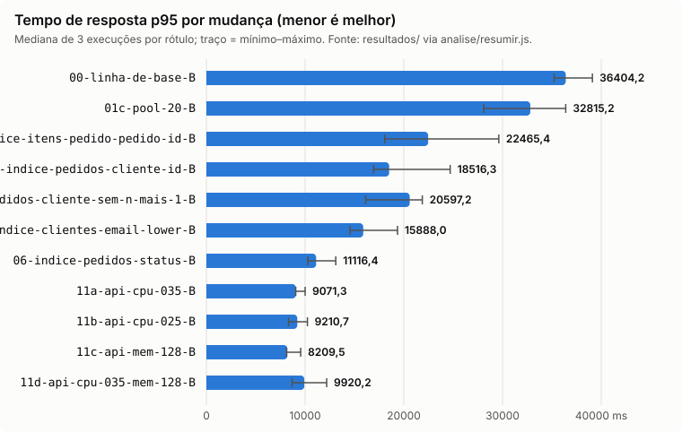

# [Título: o problema e a conclusão em uma linha]

<!--
GUIA RÁPIDO (apagar estes comentários antes de entregar)
- 800 a 1.500 palavras, sem contar Referências e Uso de IA.
- Leitor: colega de outra área de tecnologia. Explique cada termo na primeira vez.
- Toda afirmação importante aponta para uma fonte [n]; fato e opinião separados.
- Todo número vem de resultados/ (via analise/saida/resumo.md) e tem link para a pasta.
- Seções nesta ordem, sem renomear.
-->

## 1. Resumo

<!-- até 100 palavras: o problema, o que você mudou e o principal resultado medido. -->

## 2. Contexto e diagnóstico

<!-- 150 a 250 palavras. Onde a aplicação perde tempo e recursos. Como descobriu:
comando, log ou medição, com o caminho do arquivo no repositório. -->

Hipótese de causa:

- **[Problema 1]:** [uma frase]
- **[Problema 2]:** [uma frase]

## 3. Estado da arte

<!-- 200 a 350 palavras. Agrupado por ABORDAGEM, não por fonte. Mínimo de 6 fontes,
pelo menos 2 acadêmicas ou técnicas primárias. -->

### [Abordagem A]

[O que as fontes dizem, com a fonte citada.]

### [Abordagem B]

[...]

## 4. Alternativas consideradas

| Alternativa | Custo | Desempenho | Risco | Esforço |
|---|---|---|---|---|
| [A] | | | | |
| [B] | | | | |
| [C] | | | | |

<!-- 100 a 200 palavras explicando a tabela. -->

## 5. Solução escolhida e por quê

<!-- 100 a 200 palavras. A escolha, o argumento e por que descartou as outras. -->

## 6. Experimento e resultado

| Mudança | Hipótese | p95 antes → depois | req/s antes → depois | CPU/memória | Pastas de resultados | Conclusão |
|---|---|---|---|---|---|---|
| [01-...] | | | | | | |

<!-- 100 a 200 palavras. Inclua o que não funcionou. Gráfico opcional: -->
<!--  -->

## 7. Limites e testes futuros

<!-- 100 a 200 palavras. Onde pode falhar, o que não verificou, que evidência derrubaria
a conclusão e as ideias que ficaram no proximos-testes.md. -->

[Ideias não testadas](../proximos-testes.md).

## 8. Referências

1. [Autor ou organização. Título. Link. Acesso em DD/MM/2026.]

## 9. Uso de IA

[Onde usou e como verificou.]
