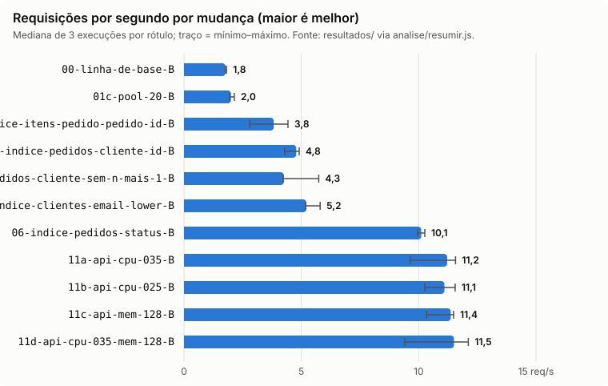

# Eficiência de uma API Node.js com PostgreSQL sob carga: efeito de índices, pool de conexões e limites de recursos sobre vazão, latência e custo de CPU

## 1. Resumo

Este trabalho investiga, de forma experimental, como reduzir a latência e o custo de execução de uma API Node.js com PostgreSQL 16 sem alterar suas respostas. O diagnóstico, por `EXPLAIN ANALYZE` e contagem de conexões, indicou o banco saturado (97% de CPU, contra 8% da API). Sete intervenções, uma por commit e medidas três vezes cada, elevaram a vazão de 1,8 para 11,5 requisições por segundo e reduziram o p95 de 36.404 para 9.920 ms, com 85% menos CPU de banco por requisição e as 42 respostas preservadas. Dois índices responderam pela maior parte do ganho.

## 2. Contexto e diagnóstico

**Objeto e método.** A aplicação expõe sete rotas de leitura sobre 100 mil clientes, 20 mil produtos, 500 mil pedidos e 1,5 milhão de itens, com a API limitada a 0,5 CPU e 256 MB e o banco a 1 CPU e 512 MB. A carga é fechada (k6): 20 usuários virtuais por 60 s, após 15 s de aquecimento. Cada configuração foi medida três vezes (mediana e faixa mínimo–máximo); faixas sobrepostas contam como ruído. As métricas são a vazão (requisições por segundo) e o p95 (valor abaixo do qual ficam 95% dos tempos de resposta). Um contrato de 42 respostas, gravado antes de qualquer alteração, garantiu que o comportamento não mudasse.

**Linha de base.** 1,8 req/s, p95 de 36.404,2 ms e 0,75% de erros ([1](../resultados/20261117-234931-00-linha-de-base-B) [2](../resultados/20261117-235149-00-linha-de-base-B) [3](../resultados/20261117-235352-00-linha-de-base-B)). O banco operou a 97,4% de CPU e a API a 7,8%: o gargalo está no PostgreSQL, não no Node.js.

**Hipóteses de causa e evidências.** Cada hipótese vem de `EXPLAIN ANALYZE` (plano executado, com tempos reais) ou da contagem de conexões por requisição. A coluna "Depois" repete o mesmo plano após a intervenção correspondente (tabela completa em [`comparativo-planos.md`](../diagnostico/comparativo-planos.md)):

| Hipótese | Evidência | Antes | Depois |
|---|---|---|---|
| Conexão nova por consulta | contagem de conexões ([rota](../diagnostico/20261116-164528-1e48069-contar-clientes-42-pedidos.txt), [controle](../diagnostico/20261116-164721-1e48069-contar-clientes-42.txt)) | `/clientes/42/pedidos`: 16–17 conexões; `/clientes/42`: 1 | pool (01c): 1,8 → 2,0 req/s |
| N+1: uma consulta para a lista e N para os detalhes | a mesma contagem | uma consulta por pedido e por item | 3 consultas fixas (03): rota -49% |
| Chave estrangeira sem índice (itens) | [plano](../diagnostico/20261116-164440-1e48069/02-explain-itens-do-pedido.txt) | 200,765 ms, Seq Scan, 499.999 linhas descartadas, 9.558 blocos | 0,106 ms, Index Scan, 7 blocos (02a) |
| Chave estrangeira sem índice (pedidos do cliente) | [plano](../diagnostico/20261116-164440-1e48069/02-explain-pedidos-do-cliente.txt) | 108,279 ms, Seq Scan, 166.665 descartadas | 0,113 ms, Index Scan (02b) |
| Filtro por e-mail sem índice | [plano](../diagnostico/20261116-164440-1e48069/02-explain-clientes-email.txt) | 76,386 ms, Seq Scan, 99.999 descartadas | 0,191 ms, Bitmap Index Scan (04) |
| Listagem por status, página 1 | [plano](../diagnostico/20261116-164440-1e48069/02-explain-pedidos-status-pagina-1.txt) | 245,200 ms, Seq Scan e ordenação | 0,107 ms, Index Scan (06) |
| Listagem por status, página 1000 | [plano](../diagnostico/20261116-164440-1e48069/02-explain-pedidos-status-pagina-1000.txt) | 779,429 ms, ordena em disco | 32,490 ms, mas 20.101 blocos lidos (06) |
| Relatórios (não tratados) | [top-produtos](../diagnostico/20261116-164440-1e48069/02-explain-top-produtos-10.txt), [vendas-por-dia](../diagnostico/20261116-164440-1e48069/02-explain-vendas-por-dia-7-dias.txt) | 3.654,548 e 878,755 ms | 2.766,131 e 124,510 ms, ainda com Seq Scan (06) |

Quatro problemas compartilham um mecanismo: varredura sequencial que descarta quase todas as linhas lidas. A página 1000 mostra que o índice não elimina o custo do `OFFSET`: o banco ainda lê 20.101 blocos. Os planos "antes" vêm da primeira máquina; o plano independe do hardware, mas os tempos isolados são apenas indicativos.

## 3. Estado da arte

### Reaproveitar conexões

No PostgreSQL, cada conexão nova leva o supervisor a criar um processo de backend [1], e o `node-postgres` recomenda um pool (conexões reaproveitadas) em aplicações web, citando 20–30 ms só no handshake [2]. O HikariCP defende pools pequenos, da ordem de núcleos × 2 + discos, calibrados sob carga [3]. Em contraponto, com 56 clientes a conexão direta alcançou cerca de 2,5 vezes a vazão do PgBouncer, um pooler externo [4].

### Eliminar consultas em laço

Chen et al. definem o *one-by-one processing* como operações de banco semelhantes repetidas em laço ("repeatedly performs similar database operations in loops") [5], equivalente ao N+1 observado. Corrigi-lo reduziu o tempo de resposta em 20% a 32% em 4 de 9 suítes de um sistema aberto e em 69% num industrial; nas demais, o efeito não foi significativo ("not all anti-patterns are worth fixing") [5]. A evidência é de ORM em Java, não de SQL direto. Um caso de mercado relata a mediana de uma página caindo de 3,41 s para 290 ms [6].

### Indexar o que a consulta filtra

Um índice (aqui, B-tree) é uma estrutura ordenada que evita varrer a tabela. Declarar chave estrangeira não cria índice [7]; um índice de expressão serve a consultas com a mesma expressão, ao custo de calculá-la a cada escrita [8]; e um índice pode entregar linhas já ordenadas, lendo só as primeiras em `ORDER BY ... LIMIT` [9]. O `OFFSET` obriga a buscar as linhas puladas, e a alternativa (*keyset*) filtra pelo último valor visto [10]; contar com exatidão é caro porque o MVCC (cada transação vê sua versão das linhas) exige checar a visibilidade linha a linha [11]. Um `DELETE` caiu de 19 s para 342 ms ao indexar chaves estrangeiras [12] (outra operação; vale pelo mecanismo).

### Medir e limitar recursos

Dean e Barroso afirmam que episódios temporários de alta latência, irrelevantes em sistemas de porte moderado, "may come to dominate overall service performance at large scale" [13]; o argumento vale para muitos servidores por requisição, e usar o p95 aqui é escolha metodológica. O k6 usa modelo fechado, no qual a carga cai quando o sistema desacelera [14], e Schroeder et al. mostram "a vast difference in behavior between open and closed models" [15]. O Docker limita CPU com `--cpus` e, por padrão, o kernel encerra processos do container em estouro de memória (OOM) [16].

### Rotas que continuam lentas: busca e relatórios

Na busca por substring, índices trigrama (`pg_trgm`) suportam `LIKE`/`ILIKE` sem âncora à esquerda, ao contrário do B-tree, mas padrões sem trigramas extraíveis degeneram em varredura do índice [17]. Nos relatórios, uma visão materializada acelera a leitura ao custo de dados defasados até o refresh [18], que sem `CONCURRENTLY` pode bloquear leituras [19]. Nenhuma foi aplicada.

### Casos de empresas

A Datadog reduziu a latência média de uma consulta de mais de 300 ms para 38 µs com um índice alinhado ao predicado (`org_id`, `dbms`), em vez de depender de um composto cuja coluna inicial a consulta não filtrava [20]. O GitLab, com PgBouncer em modo transação, baixou as conexões ativas de algumas centenas para 10–20 e o `max_connections` de 3.000 para 300, abrindo mão de *prepared statements* [21]. A Laravel Cloud reduziu a média de uma rota de 907 para 354 ms e o p95 de 1,44 s para 624 ms corrigindo N+1, dados redundantes e carga adiada [22]. Os três são ambientes maiores, e só o da Datadog isola o efeito de uma única mudança.

## 4. Alternativas consideradas

| Alternativa | Custo | Desempenho (máquina B) | Risco | Esforço |
|---|---|---|---|---|
| Pool na API (`max: 20`) | nenhum serviço novo | p95 -10% (ruído), vazão +13% | pool pequeno enfileira | baixo |
| PgBouncer | mais um container | não testado; pode piorar [4] | restringe recursos de sessão | médio |
| Índices B-tree | 4,7 a 21 MB cada; escrita mais lenta | vazão 2,0→3,8 (02a), 5,2→10,1 (06) | não é usado se a expressão difere | baixo |
| 3 consultas fixas no N+1 | nenhum | rota-alvo -49%; geral no ruído | ordem e tipos do contrato | médio |
| `json_agg` no banco | nenhum | não testado | formato de data pode quebrar o contrato | médio |
| Reduzir limites da API | -10% CPU, -17% memória reservados | geral no ruído; 0,25 CPU piora rotas leves | OOM, fila | baixo |
| Mais CPU ao banco | sobe a conta | não testado | contraria "mais barato" | baixo |
| Índice trigrama (`pg_trgm`) na busca | índice adicional | não testado [17] | padrão curto degenera em varredura | médio |
| Visão materializada nos relatórios | guardar e atualizar o resultado [19] | não testado [18] | dado defasado quebra o contrato | alto |

O PgBouncer foi descartado por acrescentar um serviço e porque a fonte indica perda em escala pequena [4]; o `json_agg`, pelo risco ao formato de datas; mais CPU ao banco, por tratar o sintoma com uma conta maior. Mantiveram-se um índice por commit, para atribuir cada ganho a uma causa, e três consultas fixas com `ANY` no N+1, que preservam a ordem do contrato.

## 5. Solução escolhida e por quê

**Argumento.** Com o banco saturado e a API a 8% de CPU, reduzir o trabalho por consulta tinha precedência sobre ajustar recursos. A ordem seguiu esse raciocínio: pool, índices, N+1 e, por último, limites de recursos. Cada intervenção teve hipótese própria (seção 6), commit isolado e contrato verificado.

**Mecanismo e evidência.** Na mudança 06, o índice composto casa o filtro (`status`) e a ordenação (`criado_em`, `id`) [9]: o plano da página 1 deixou de varrer e ordenar ([plano depois](../diagnostico/20261118-014212-a8050f5/02-explain-pedidos-status-pagina-1.txt)) e a vazão dobrou (5,2 → 10,1 req/s, faixas separadas).

**Aplicação prática (opinião do autor, não testada):** (1) começar pelo `EXPLAIN` das listagens e filtros mais usados; (2) criar índices sem travar escritas exige `CREATE INDEX CONCURRENTLY` (não testado); (3) medir o custo de escrita antes de acumular índices; (4) olhar o p95 **por rota** ao cortar recursos (seção 6).

## 6. Experimento e resultado

Máquina B (i5-9300H, 15,8 GB), base `00-linha-de-base-B`; medianas de 3 execuções. CPU em % e memória em MiB, API / banco.
| Mudança | Hipótese | p95 (ms) | req/s | CPU · MiB | Pastas | Conclusão |
|---|---|---|---|---|---|---|
| 00 base | — | 36404,2 | 1,8 | 7,8 · 29 / 97,4 · 402 | [1](../resultados/20261117-234931-00-linha-de-base-B) [2](../resultados/20261117-235149-00-linha-de-base-B) [3](../resultados/20261117-235352-00-linha-de-base-B) | ponto de partida |
| 01c pool 20 | sem fila por conexão | → 32815,2 | → 2,0 | 7,1 · 40 / 97,9 · 399 | [1](../resultados/20261117-235903-01c-pool-20-B) [2](../resultados/20261118-000102-01c-pool-20-B) [3](../resultados/20261118-000259-01c-pool-20-B) | p95 no ruído; vazão +13% |
| 02a índice itens | tira varredura | → 22465,4 | → 3,8 | 13,4 · 58 / 97,5 · 403 | [1](../resultados/20261118-002526-02a-indice-itens-pedido-pedido-id-B) [2](../resultados/20261118-002729-02a-indice-itens-pedido-pedido-id-B) [3](../resultados/20261118-002924-02a-indice-itens-pedido-pedido-id-B) | vazão +91% |
| 02b índice pedidos | idem | → 18516,3 | → 4,8 | 14,6 · 62 / 96,9 · 406 | [1](../resultados/20261118-003225-02b-indice-pedidos-cliente-id-B) [2](../resultados/20261118-003412-02b-indice-pedidos-cliente-id-B) [3](../resultados/20261118-003558-02b-indice-pedidos-cliente-id-B) | rota-alvo -75%; geral no ruído |
| 03 N+1 | menos idas ao banco | → 20597,2 | → 4,3 | 13,1 · 70 / 97,9 · 412 | [1](../resultados/20261118-010222-03-pedidos-cliente-sem-n-mais-1-B) [2](../resultados/20261118-010425-03-pedidos-cliente-sem-n-mais-1-B) [3](../resultados/20261118-010621-03-pedidos-cliente-sem-n-mais-1-B) | rota-alvo -49%; geral no ruído |
| 04 `lower(email)` | tira varredura | → 15888,0 | → 5,2 | 16,0 · 67 / 97,3 · 404 | [1](../resultados/20261118-012627-04-indice-clientes-email-lower-B) [2](../resultados/20261118-012814-04-indice-clientes-email-lower-B) [3](../resultados/20261118-013006-04-indice-clientes-email-lower-B) | rota-alvo -79%; geral no ruído |
| 06 status composto | filtro e ordem no índice | → 11116,4 | → 10,1 | 20,0 · 67 / 96,8 · 429 | [1](../resultados/20261118-013722-06-indice-pedidos-status-B) [2](../resultados/20261118-013859-06-indice-pedidos-status-B) [3](../resultados/20261118-014038-06-indice-pedidos-status-B) | vazão +94%, p95 -30% |
| 11 API 0,35 CPU, 128 MiB | limite maior que o uso | → 9920,2 | → 11,5 | 20,4 · 63 / 98,2 · 426 | [1](../resultados/20261118-071632-11d-api-cpu-035-mem-128-B) [2](../resultados/20261118-071809-11d-api-cpu-035-mem-128-B) [3](../resultados/20261118-071948-11d-api-cpu-035-mem-128-B) | no ruído; reserva menor |

**Leitura dos resultados.** A vazão subiu 6,5 vezes e o p95 caiu 73%, sobretudo pelos índices 02a e 06. Para o custo, o mais informativo é a CPU por requisição: no banco caiu de 555,8 para 85,3 ms (-85%) e na API de 44,5 para 17,7 ms, mais que a reserva reduzida (-10% de CPU, -17% de memória); cálculo em [`resumo.md`](../analise/saida/resumo.md).

**O que não funcionou ou foi marginal.** O pool alterou pouco o p95; o N+1 melhorou apenas a rota-alvo; e 0,25 CPU na API elevou o p95 de `cliente` e `pedidos-do-cliente` de 492,3 e 1002,0 para 1239,1 e 1811,2 ms sem alterar o agregado (série 11b): o p95 geral pode ocultar degradações em rotas leves. Com 0,35 CPU e 128 MiB voltaram a 486,5 e 997,7 ms (série 11d), sem OOM (pico de 99,1 MiB). Detalhes em [`experimentos.md`](../experimentos.md).

## 7. Limites e testes futuros

**Validade interna.**
- A RAM livre do host variou de 851 a 2.397 MB entre séries; 04, 06 e 11a começaram com menos de 1 GB livre, e o efeito não foi verificado.
- Três execuções por série limitam o poder estatístico.
- O "arquivos sem commit" do `contexto.txt` (1, 2 e 3) vem de o `medir.sh` contar a pasta da própria execução ([explicação](../experimentos.md)).

**Validade externa.**
- O k6 usa modelo fechado, de modo que o p95 pode subestimar o pior caso [14][15]; carga aberta não foi testada.
- O teste só lê: o custo dos índices (4,7 a 21 MB) em INSERT e UPDATE não foi medido.
- Os números valem para a máquina B; a primeira é histórico, e dela vêm os planos de 02a, 02b e 03.

**O que refutaria a conclusão.** Outro hardware com as faixas de 02a e 06 sobrepostas, ou uma carga aberta em que o p95 piore.

**Trabalhos futuros.** O próximo gargalo são `vendas-por-dia` e `top-produtos` (p95 acima de 14 s); ver [ideias não testadas](../proximos-testes.md).

## 8. Referências

1. PostgreSQL Global Development Group. *How Connections Are Established* (PostgreSQL 16). https://www.postgresql.org/docs/16/connect-estab.html. Acesso em 13/11/2026.
2. node-postgres. *Pooling*. https://node-postgres.com/features/pooling. Acesso em 13/11/2026.
3. HikariCP. *About Pool Sizing*. https://github.com/brettwooldridge/HikariCP/wiki/About-Pool-Sizing. Acesso em 13/11/2026.
4. Camargos, F. L. (Percona). *Scaling PostgreSQL with PgBouncer: You May Need a Connection Pooler Sooner Than You Expect*. 27/06/2018. https://www.percona.com/blog/scaling-postgresql-with-pgbouncer-you-may-need-a-connection-pooler-sooner-than-you-expect/. Acesso em 13/11/2026.
5. Chen, T.-H.; Shang, W.; Jiang, Z. M.; Hassan, A. E.; Nasser, M.; Flora, P. *Detecting performance anti-patterns for applications developed using object-relational mapping*. ICSE 2014. https://doi.org/10.1145/2568225.2568259. Acesso em 17/11/2026.
6. McKerlie, A. (Sentry). *Finding and Fixing Django N+1 Problems*. 14/09/2020. https://blog.sentry.io/finding-and-fixing-django-n-1-problems/. Acesso em 13/11/2026.
7. PostgreSQL Global Development Group. *Constraints* (PostgreSQL 16, seção 5.4). https://www.postgresql.org/docs/16/ddl-constraints.html. Acesso em 13/11/2026.
8. PostgreSQL Global Development Group. *Indexes on Expressions* (PostgreSQL 16). https://www.postgresql.org/docs/16/indexes-expressional.html. Acesso em 17/11/2026.
9. PostgreSQL Global Development Group. *Indexes and ORDER BY* (PostgreSQL 16). https://www.postgresql.org/docs/16/indexes-ordering.html. Acesso em 13/11/2026.
10. Winand, M. *We need tool support for keyset pagination*. https://use-the-index-luke.com/no-offset. Acesso em 13/11/2026.
11. PostgreSQL Wiki. *Slow Counting*. https://wiki.postgresql.org/wiki/Slow_Counting. Acesso em 13/11/2026.
12. Fritz, E. (Render). *Fix a top cause of slow queries in PostgreSQL (no slow query log needed)*. 12/12/2024. https://render.com/blog/postgresql-top-cause-slow-queries. Acesso em 13/11/2026.
13. Dean, J.; Barroso, L. A. *The Tail at Scale*. Communications of the ACM 56(2), 2013. https://doi.org/10.1145/2408776.2408794. Acesso em 17/11/2026.
14. Grafana k6. *Open and closed models*. https://grafana.com/docs/k6/latest/using-k6/scenarios/concepts/open-vs-closed/. Acesso em 13/11/2026.
15. Schroeder, B.; Wierman, A.; Harchol-Balter, M. *Open Versus Closed: A Cautionary Tale*. NSDI 2006. https://www.usenix.org/conference/nsdi-06/open-versus-closed-cautionary-tale. Acesso em 17/11/2026.
16. Docker. *Resource constraints*. https://docs.docker.com/engine/containers/resource_constraints/. Acesso em 13/11/2026.
17. PostgreSQL Global Development Group. *pg_trgm* (PostgreSQL 16). https://www.postgresql.org/docs/16/pgtrgm.html. Acesso em 13/11/2026.
18. PostgreSQL Global Development Group. *Materialized Views* (PostgreSQL 16, seção 41.3). https://www.postgresql.org/docs/16/rules-materializedviews.html. Acesso em 13/11/2026.
19. PostgreSQL Global Development Group. *REFRESH MATERIALIZED VIEW* (PostgreSQL 16). https://www.postgresql.org/docs/16/sql-refreshmaterializedview.html. Acesso em 16/11/2026.
20. Noveljic, N.; Chen, B. (Datadog). *Not all index scans are equal: How we cut query latency by over 99%*. 09/04/2026. https://www.datadoghq.com/blog/detect-inefficient-index-scans-with-dbm. Acesso em 18/11/2026.
21. Peterse, Y. (GitLab). *Scaling the GitLab database*. 02/10/2017. https://about.gitlab.com/blog/scaling-the-gitlab-database. Acesso em 18/11/2026.
22. Guimarães, M.; Beggs, J. (Laravel). *Cutting Laravel Cloud Load Times by 60% with Nightwatch*. 27/03/2026. https://laravel.com/blog/cutting-laravel-cloud-load-times-by-60-with-nightwatch. Acesso em 18/11/2026.

## 9. Uso de IA

Declaro o uso de um assistente de IA generativa (Claude Code, da Anthropic) como ferramenta de apoio à análise do código, à execução dos diagnósticos e das medições, à consolidação dos dados e à redação preliminar deste artigo e do `experimentos.md`, ambos revisados por mim. A formulação das hipóteses, a ordem das intervenções, o descarte de alternativas e as conclusões são de minha autoria. A verificação seguiu três critérios: (i) todo valor de antes e depois provém do `medir.sh` e de `resultados/`, consolidado por script, sem transcrição manual; (ii) cada intervenção só foi considerada válida com o contrato de respostas (42 casos) preservado; (iii) cada fonte foi consultada diretamente e confrontada com o trecho citado, e o texto foi corrigido quando a fonte não sustentava a afirmação.
